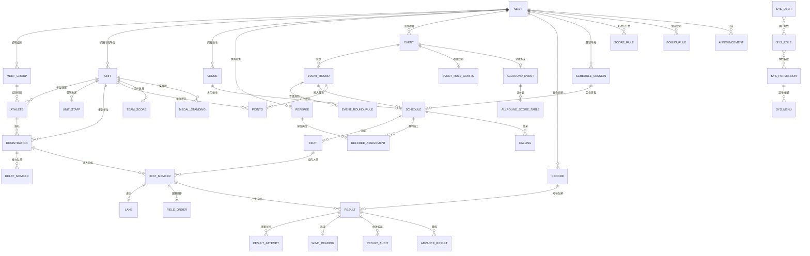

# 数据库 ER 说明

> 数据库：MySQL 8.0 ｜ 字符集：`utf8mb4` / `utf8mb4_0900_ai_ci` ｜ 引擎：InnoDB
> 命名规范：表名小写下划线；业务表主键 `id BIGINT UNSIGNED AUTO_INCREMENT`；外键字段 `<实体>_id`；布尔 `is_xxx TINYINT(1)`；时间 `xxx_time DATETIME`；日期 `xxx_date DATE`；金额/分值 `DECIMAL(10,2)`；成绩 `DECIMAL(10,2)` 或 `VARCHAR(16)`（见 4.3）。
> **注意**：MySQL 8 中 `group`、`rank`、`system` 等为保留字，实际表名使用 `meet_group` 等；系统表统一 `sys_` 前缀（见第 5 节映射表）。

---

## 1. 分层结构

| 层 | 表前缀 | 说明 | 多届隔离 |
| --- | --- | --- | --- |
| L1 系统层 | `sys_` | 用户、角色、权限、菜单、字典、日志、配置、备份 | 全局（不隔离） |
| L2 届次基础层 | 无前缀（`meet_*`、`unit`、`venue`、`referee`、`record`） | 一届运动会的组织性基础数据 | `meet_id` |
| L3 人员报名层 | `athlete`、`registration`、`relay_member` | 参赛主体与报名关系 | `meet_id` |
| L4 项目规则层 | `event*`、`score_rule*`、`allround_*`、`bonus_rule` | 项目定义与全部可配置规则 | `meet_id` |
| L5 编排层 | `schedule_session`、`schedule`、`heat`、`heat_member`、`lane`、`field_order`、`conflict_log` | 编排输入输出的结果数据 | `meet_id` |
| L6 赛前层 | `calling`、`draw_record`、`referee_assignment` | 检录、抽签、裁判分工 | `meet_id` |
| L7 成绩层 | `result`、`result_attempt`、`wind_reading`、`result_audit`、`advance_result` | 成绩与晋级 | `meet_id` |
| L8 统计层 | `points`、`team_score`、`medal_standing` | 积分与榜单单据/快照 | `meet_id` |
| L9 输出层 | `announcement`、`print_template`、`certificate` | 公告、打印模板、证书 | `meet_id` 或全局模板 |

---

## 2. ER 图（核心实体）



---

## 3. 关键实体关系说明

### 3.1 届次与基础数据
- `meet` 是**根实体**，其下所有业务数据通过 `meet_id` 关联，构成多届隔离边界。
- `meet_group`（组别）隶属于 `meet`；一个组别可设置性别、年龄约束、是否计团体分。
- `unit`（参赛单位）隶属于 `meet`；`unit_staff` 记录领队/教练。
- `venue`（场地）隶属于 `meet`，含 `lane_count`（道数，用于道次分配算法）。
- `referee` 记录裁判与工作人员，`referee_assignment` 关联到 `schedule` 形成分工。

### 3.2 运动员与报名
- `athlete` 同时关联 `meet_id` + `group_id` + `unit_id`，是参赛的「人」。
- `registration` 是 `athlete` × `event` 的报名关系（个人项目 1 行 1 人；接力项目 1 行 N 人）。
  - 个人项目：`registration.athlete_id` 非空，`relay_member` 为空。
  - 接力项目：`registration.is_relay=1`，`relay_member` 记录 4 名队员及棒次。
- 唯一约束防重复：`uk(meet_id, event_id, athlete_id)`（个人项）；接力用 `uk(meet_id, event_id, unit_id)`。
- 报名限制与冲突校验结果写入 `registration.check_result_json`（快照，可追溯）。

### 3.3 项目与轮次
- `event` 定义项目属性（类型、组别、性别、赛制、是否接力、预计时长、每单位限报）。
- `event_round` 定义轮次（`PRE`/`QUALIFY`/`SEMI`/`FINAL`/`HEAT2`），字段 `round_no` 排序、`is_final` 标记。
- 规则三层继承：
  - `meet.config_json`（届次默认，JSON）
  - `event_rule_config`（项目级，结构化列 + JSON 扩展）
  - `event_round_rule`（轮次级：晋级人数、目标人数、录取名次）
- `score_rule` + `score_rule_item` 保存名次分表；`bonus_rule` 保存破纪录/接力加分规则。
- `allround_event` 保存全能项目的单项构成与顺序；`allround_score_table` 保存计分表（成绩段 → 分值）。

### 3.4 编排链路（核心）
```
schedule_session (单元: 日期/半天/起止时间)
      └── schedule (日程条目: event_round × venue × 时间窗 × 组数 × 时长 × locked)
              └── heat (分组: 组号 × 道数 × 检录时间 × 状态)
                      └── heat_member (参赛人: registration_id × 号码 × 出发顺序)
                              ├── lane (道次: lane_no × 分配方式)
                              └── field_order (田赛出场顺序: order_no)
```
- 一次「自动编排」事务内写入 `schedule_session→schedule→heat→heat_member→lane/field_order`。
- `locked` 在 `schedule`、`heat`、`lane` 三级均存在，重新生成时作为固定约束。
- `conflict_log` 独立保存冲突检测结果，字段含类型、涉及对象、严重级别、是否已处理。

### 3.5 成绩与晋级
- `result` 以 `heat_member_id` 或 `(schedule_id, registration_id)` 定位，字段含：
  - `result_raw`（原始录入，如 `11"23`）、`result_value DECIMAL(10,2)`（用于排序）、`result_unit`（s/m/cm/分）
  - `rank_no`（名次）、`status`（`VALID`/`DNS`/`DNF`/`DSQ`/`NM`/`PASS`）
  - `is_record_candidate` / `is_record_confirmed` / `record_id`
  - `wind_speed`（关联 `wind_reading` 或内联）、`audit_status`（`DRAFT`/`SUBMITTED`/`APPROVED`/`REJECTED`）
- 田赛多次成绩写入 `result_attempt`（`attempt_no` × `attempt_value` × 是否成功/免跳/犯规）。
- 全能：`result` 表示单项成绩与得分，`allround_*` 关联总分（可在 `result` 增加 `allround_group_id` 归并单项）。
- 晋级：`advance_result` 保存「从哪个轮次来 → 到哪个轮次去」的名单（含 `advance_type`：`GROUP_TOP`/`BEST_LOSER`/`MANUAL`）。
- 修改留痕：`result_audit` 保存前后值与原因；写入主表时同步写 `sys_operation_log`。

### 3.6 统计与输出
- `points` 为积分明细：`(meet_id, unit_id, event_id, round_id, registration_id, rank_no, rank_point, bonus_point, relay_factor, total_point)`。
- `team_score` 为按 `(meet_id, group_id, unit_id, score_type)` 的快照聚合（`score_type`：`MALE`/`FEMALE`/`TOTAL`）。
- `medal_standing` 为奖牌榜快照（金/银/铜 + 排序分）。
- `certificate` 保存证书编号、类型、模板、收件人、生成文件路径、二维码内容。
- `announcement` 支持公开/定向可见与置顶；`print_template` 支持届次级覆盖全局模板。

---

## 4. 设计规范

### 4.1 通用字段（所有业务表）
| 字段 | 类型 | 说明 |
| --- | --- | --- |
| `id` | BIGINT UNSIGNED PK AUTO_INCREMENT | 主键 |
| `meet_id` | BIGINT UNSIGNED | 届次隔离字段（系统表除外），建索引 |
| `create_by` / `create_time` | BIGINT / DATETIME | 创建人与时间（默认 `CURRENT_TIMESTAMP`） |
| `update_by` / `update_time` | BIGINT / DATETIME | 修改人与时间（`ON UPDATE CURRENT_TIMESTAMP`） |
| `deleted` | TINYINT(1) DEFAULT 0 | MyBatis-Plus 逻辑删除 |
| `version` | INT DEFAULT 0 | 乐观锁（成绩、编排等并发场景） |

### 4.2 索引策略
- 所有 `meet_id` 建索引（多数查询以届次为前缀）。
- 复合索引顺序遵循「等值列在前、范围/排序列在后」：如 `idx_meet_event_status(meet_id, event_id, audit_status)`。
- 关联表建唯一约束：`athlete(meet_id, id_card)`、`registration(meet_id, event_id, athlete_id)`、`lane(heat_id, lane_no)`。
- `sys_operation_log` 按 `create_time` 建索引并支持按月分区（可选）。
- 大文本 JSON 字段仅用于规则与快照，避免出现在高频繁查询的 WHERE 条件中。

### 4.3 成绩字段建模约定
| 场景 | 存储方式 |
| --- | --- |
| 径赛时间 | `result_raw`（显示字符串，如 `1:02.45`）+ `result_value`（秒，DECIMAL(10,2) 用于排序比较） |
| 田赛远度 | `result_value` + `result_unit='m'`，取最好一次入 `result`，全部试跳入 `result_attempt` |
| 田赛高度 | 同上，`result_unit='m'`，并记录 `final_height` |
| 全能单项分 | `result_score`（单项得分）+ `result_value`（原始成绩） |
| 全能总分 | `result_value`（总分），`result_unit='pt'` |
| 无效成绩 | `status` 标记，`result_value` 置空，排序时排在有效成绩之后 |

### 4.4 多届数据隔离与数据权限
1. **物理隔离**：全部业务表带 `meet_id`，所有 Mapper 默认拼接 `meet_id` 条件（MyBatis-Plus 多租户插件，`meet_id` 作为租户列，系统表排除）。
2. **行级数据权限**：`TEAM_LEADER` 追加 `unit_id = 当前用户单位`；`REFEREE` 追加 `schedule_id IN (被分配项目)`；`ATHLETE` 追加 `athlete_id = 本人`。
3. **越权防护**：Service 层对 `meet_id`/`unit_id` 二次校验，禁止仅依赖前端传参。

### 4.5 审计与留痕
- 所有写操作记 `sys_operation_log`（模块、动作、目标 ID、参数摘要、IP、耗时、结果）。
- 关键业务（成绩、规则、编排、报名审核）额外写业务留痕表：`result_audit`、`conflict_log`、`draw_record`，并保存 `before_json` / `after_json`。

---

## 5. 表名映射（需求 → 实现）

| 需求文档中的表名 | 实现表名 | 原因 |
| --- | --- | --- |
| `meet` | `meet` | 一致 |
| `group` | `meet_group` | `GROUP` 为 MySQL 保留字 |
| `unit` | `unit` | 一致 |
| `athlete` | `athlete` | 一致 |
| `event` | `event` | 一致 |
| `event_round` | `event_round` | 一致 |
| `registration` | `registration` | 一致 |
| `schedule` | `schedule`（+ 单元表 `schedule_session`） | 一致，并细分竞赛单元 |
| `heat` | `heat` | 一致 |
| `lane` | `lane` | 一致 |
| `result` | `result`（+ `result_attempt`） | 一致，并细分田赛试跳 |
| `score_rule` | `score_rule` + `score_rule_item` | 主表 + 明细，支持一表多方案 |
| `points` | `points`（+ `team_score` 快照） | 明细 + 快照 |
| `record` | `record` | 一致 |
| `venue` | `venue` | 一致 |
| `referee` | `referee` + `referee_assignment` | 人员 + 分工 |
| `user` | `sys_user` | 统一前缀，避免与保留字/业务语义冲突 |
| `role` | `sys_role` | 同上 |
| `permission` | `sys_permission` | 同上 |
| `operation_log` | `sys_operation_log` | 同上 |
